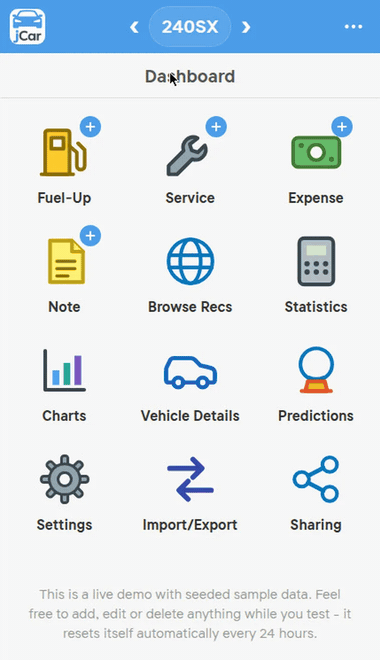

#  jCar

jCar is a web app for tracking a vehicle's fuel, service and expenses designed primary for use on mobile but works great on desktop browsers as well. It was created out of frustration of existing self hosted options not including certain useful features that I was used to as a paid user of an app that will not be mentioned :).  My goal was to re-create the experience of my favorite paid app without its limitations while also bringin it in to the modern world with some basic auto-fill and sharing functionality.  jCar runs as one small container on your own server and works like a phone app, including an "Add to Homescreen" shortcut so it opens full screen with its own icon just like a normal app does.

Everything is per user. Each account has its own vehicles, and a vehicle can be shared with another account by invite, so two people can both maintain records on the same car.

<p align="center">
  
  <br>
  <sub>Animation is a simulated demonstration only. The production app runs smooth.</sub>
</p>

## What it does

- Fuel-ups, services, expenses and notes, with photos attached if you want
  them
- Fuel economy that handles partial and missed fill-ups properly, so the
  averages stay honest
- Statistics, charts and predictions (next fuel-up, range, trip costs)
- Vehicle details and a parts list with the specs you look up twice a year
- Vehicle sharing by invite, the other person can add and edit records but
  cannot delete the vehicle
- Imports from aCar (.abp backups), Fuelio, Fuelly CSV, Drivvo, Spritmonitor,
  Motostat, Fuel Log and generic CSV files, plus jCar's own backup format.
- Exports to CSV and a full JSON backup
- AI Auto Fill (optional): photograph a receipt or the pump and the fuel-up
  form fills itself in, using an AI endpoint you configure.  In testing
  I've found that Gemma 4 31b through openrouter does this reliably for
  around 0.3 cents per image
- Light and dark themes, your choice of units and date formats

## Quick start

Docker Compose

```bash
mkdir jcar && cd jcar
curl -O https://raw.githubusercontent.com/jammin1911/jcar/main/docker-compose.yml
curl -O https://raw.githubusercontent.com/jammin1911/jcar/main/.env.example
cp .env.example .env
```

Edit `.env` and set `ORIGIN` to the address you will open jCar at, for
example `http://192.168.1.50:3000` on a home network or
`https://jcar.example.com` behind a reverse proxy. Then:

```bash
docker compose up -d
```

Open the address, sign in as `admin` with any password, and the app walks
you through creating the admin account (you pick the username and a
password of at least 8 characters). That account is the administrator.
Everyone else makes their own account through Register.

To update later: `docker compose pull && docker compose up -d`.

## Running from source

```bash
git clone https://github.com/jammin1911/jcar.git
cd jcar
docker build -t jcar:local .
cp .env.example .env   # set ORIGIN at minimum
```

Then change the `image:` line in docker-compose.yml to `jcar:local`
and `docker compose up -d` as above.

Or without Docker: Node 22, `npm ci`, `npm run build`, then
`node build` with the environment set.

## Configuration

Everything is set through environment variables, `.env.example` documents
each one. The short version:

- `ORIGIN` is the one that matters. Form posts are checked against it.
  Plain http works fine for sign-in. One catch: browsers only offer
  Add to Homescreen (and the full screen app feel) on https or on
  localhost, so put a reverse proxy with a certificate in front if
  you want that, or use it in a normal browser tab, which also works.
- AI Auto Fill is off until you set `AI_API_BASE_URL` and `AI_MODEL`.
  It talks to any OpenAI compatible endpoint, hosted or local.
- Plans are off by default and the app runs unlimited. `PLANS_ENABLED`
  exists for the hosted service, ignore it.

## Your data

Everything lives in the `./data` folder beside the compose file: one
SQLite database (`jcar.db`) and a `photos` folder. Back up that folder
and you have everything, restore is putting it back and starting the
container. Records are never deleted by the app on a schedule, there
is no telemetry, and the only optional outbound calls are the ones you
configure (an AI endpoint, an ntfy topic, an analytics script).

## AI Disclosure

AI powered tools were used in various parts of creating this app, with complete human oversight of the work. The server infrastructure behind the hosted version of jCar uses no AI at all. It is designed, configured and maintained entirely by a human.

## License

MIT, see LICENSE.
